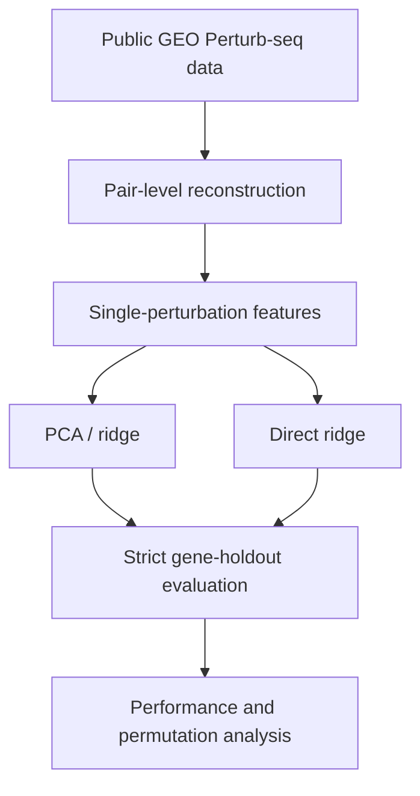

<div align="center">

# GeneRx-FATE

**Predicting nonadditive genetic interactions from single-perturbation transcriptomics**


[](https://www.ncbi.nlm.nih.gov/geo/query/acc.cgi?acc=GSE133344)

[Overview](#overview) · [Reproduction](#reproduce-the-k562-benchmark) · [Results](#results) · [Data citation](#data-citation)

</div>

---

## Overview

GeneRx-FATE predicts the nonadditive component of paired CRISPRa responses from single-perturbation expression signatures. This repository contains the analysis for Norman K562 Perturb-seq (GSE133344), the strict gene-holdout comparison, and the exploratory Central Dogma Interaction Equation (CDIE) simulator.

### Repository guide

| Analysis | Implementation |
|---|---|
| Rebuild pair-level inputs from GEO and repeat the model comparison | [reproduce.py](reproduce.py) |
| Fit the B3 baseline and low-rank residual model | [generx_fate.py](generx_fate.py) |
| Compare PCA/ridge with direct ridge on matched splits | [benchmark.py](benchmark.py) |
| Reproduce the fixed-split conditional feature-shuffling test | [permutation.py](permutation.py) |
| Run the synthetic-variant simulation and public-assay benchmarks | [CDIE](cdie/README.md) |

### Analysis workflow



## Reproduce the K562 benchmark

Use Python 3.11 or later, a C++ compiler (`g++`), and `gzip`. Install dependencies with `python -m pip install -r requirements.txt`. Then download the following files from the [GSE133344 supplementary directory](https://ftp.ncbi.nlm.nih.gov/geo/series/GSE133nnn/GSE133344/suppl/) into a local directory named `geo`.

- `GSE133344_filtered_matrix.mtx.gz`
- `GSE133344_filtered_barcodes.tsv.gz`
- `GSE133344_filtered_cell_identities.csv.gz`

```bash
sha256sum -c SHA256SUMS
OPENBLAS_NUM_THREADS=4 python reproduce.py geo results
OPENBLAS_NUM_THREADS=4 python permutation.py results/pairs_reconstructed.npz --out results/permutation
```

The workflow regenerates numerically equivalent pair arrays from GEO. `S_source_pairs_integrity.json` records the historical frozen file hash. The regenerated archive can differ at the byte level. The archived [holdout results](S_frozen_observed_unique_pairs.csv) and [audit tables](evidence/) provide comparison values.

## Results

| Evaluation metric | Reported value |
|---|---:|
| Unique held-out gene pairs | 92 |
| Test appearances | 172 |
| PCA/ridge additive-relative R² | 0.33522 |
| Direct ridge additive-relative R² | 0.33611 |
| Conditional feature shuffles | 200 |
| One-sided Monte Carlo p-value | 0.004975 |


Across 92 held-out pairs and 172 test appearances, the additive-relative R² was 0.33522 for rank-one PCA/ridge and 0.33611 for exploratory direct ridge. Both used the same six features and strict gene-holdout splits. The 200-shuffle rerun reproduced the one-sided Monte Carlo p-value of 0.004975. See [benchmark.json](benchmark.json) for pooled SSE and differences against the archived results. This benchmark uses one CRISPRa dataset. The CDIE simulator illustrates synthetic perturbations, and its public-assay benchmarks evaluate individual projections.

## Data citation

Norman TM, Horlbeck MA, Replogle JM, et al. Exploring genetic interaction manifolds constructed from rich single-cell phenotypes. *Science*. 2019;365:786–793. https://doi.org/10.1126/science.aax4438
